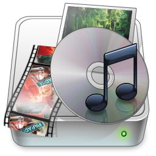

<!-- software-count: 1 -->
#  格式工厂（Format Factory）

## 软件简介

格式工厂是一款 Windows 多媒体格式转换工具，可处理视频、音频和图片，也提供裁切、合并等常见媒体处理功能。

本文依据[开发方产品与下载页面](https://www.pcfreetime.com/formatfactory/index.php?language=en)整理，核对日期：2026-09-28。该页面当前将系统标为 Windows；具体功能与界面以所下载版本为准。

## 安装方法

1. 访问[格式工厂产品与下载页面](https://www.pcfreetime.com/formatfactory/index.php?language=en)，从其下载入口获取 Windows 安装包。
2. 运行安装程序，逐项查看安装选项和目标目录，完成后启动格式工厂。
3. 如需便携使用，应先确认下载来源和包的说明，不要仅凭本机已有的程序目录推断官网提供相同包型。

## 功能特点

- **音视频转换**：选择目标格式或预设，转换常见视频和音频文件。
- **简单编辑**：按需裁切、拼接、分割或混合媒体文件。
- **其他格式处理**：产品页面还列有图片转换、光盘提取及部分 PDF 功能；这些功能不等同于专业编辑软件的完整工作流。

## 使用方法

1. 先备份原文件，并确认需要的是改变容器格式、重新编码，还是仅调整文件大小。
2. 在软件中选择目标音频或视频格式，添加源文件。
3. 根据用途检查编码参数和输出目录，再开始转换。
4. 完成后播放抽查画面、声音、时长和字幕，确认结果符合需求。

重新编码可能改变画质或音质，输出文件扩展名相同也不能保证编码参数相同。

## 官方文档与相关链接

- [格式工厂产品页面与下载](https://www.pcfreetime.com/formatfactory/index.php?language=en)
- [开发方网站](https://www.pcfreetime.com/)

---

### [回到 Windows 音视频软件目录](README.md)
