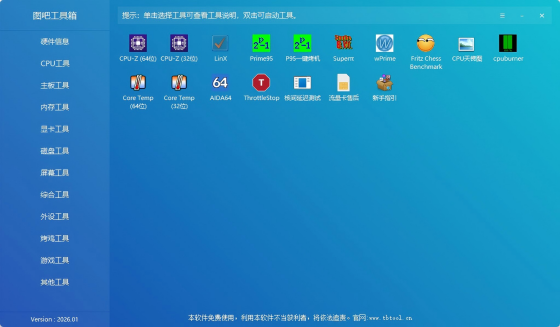

<!-- software-count: 2 -->
# 目录 <!-- omit in toc -->
- [图拉丁吧工具箱](#图拉丁吧工具箱)
  - [安装](#安装)
  - [内置工具速览](#内置工具速览)
  - [常用场景](#常用场景)
  - [注意事项](#注意事项)
  - [相关链接](#相关链接)
- [图吧工具箱 CE](#图吧工具箱ce)
  - [安装](#安装-1)
  - [特色功能](#特色功能)
  - [相关链接](#相关链接-1)

# 图拉丁吧工具箱

图拉丁吧工具箱（简称图吧工具箱）是一款面向 PC 爱好者的 Windows 系统检测与硬件测试工具集，由"图拉丁吧"社区维护。它本身是一个启动器，将数十款常用的免费硬件工具集成在一个界面中，涵盖 CPU、内存、显卡、硬盘、屏幕、外设等各类硬件的检测、跑分与压力测试，省去逐一寻找和下载的麻烦。

> 图吧工具箱本身不含恶意代码，但部分防病毒软件可能对其启动器或内置工具报毒（误报），建议从官网下载并自行甄别。



## 安装

1. 访问[官网](https://www.tbtool.cn/)下载最新版本的安装包（`.exe` 或 `.zip`）。
2. 推荐下载完整版以获取全部内置工具，也可按需选择精简版。
3. 解压或安装到任意目录即可运行。

> 图吧工具箱为绿色软件，无需安装到系统目录，可直接放在非系统盘使用。

## 内置工具速览

图吧工具箱按功能分类集成了以下常用工具：

| 分类 | 工具（部分） | 用途 |
|------|-------------|------|
| CPU | CPU-Z、Core Temp、Prime95 | 处理器信息、温度监控、压力测试 |
| 内存 | MemTest、Thaiphoon Burner | 内存稳定性测试、SPD 信息读取 |
| 显卡 | GPU-Z、FurMark、MSI Afterburner | 显卡信息、烤机测试、超频与监控 |
| 硬盘 | CrystalDiskInfo、CrystalDiskMark、DiskGenius、[SpaceSniffer](文件管理器/SpaceSniffer.md) | 硬盘健康状态、读写测速、分区管理、磁盘空间分析 |
| 屏幕 | DisplayX、Dead Pixel Tester | 屏幕坏点检测、显示器综合测试 |
| 综合 | AIDA64、HWiNFO | 全硬件信息汇总、传感器监控 |
| 外设 | Keyboard Test、MouseTester | 键盘冲突测试、鼠标性能检测 |

## 常用场景

| 场景 | 推荐工具与操作 |
|------|---------------|
| 新机验机 | AIDA64 查看整机配置 → CPU-Z/GPU-Z 核对参数 → DisplayX 查坏点 → CrystalDiskInfo 看硬盘通电时间 |
| 内存稳定性排查 | MemTest 或 RunMemTestPro 跑至少 200% 覆盖 |
| 显卡烤机 | FurMark 运行 15~30 分钟，观察温度与是否花屏 |
| 硬盘测速 | CrystalDiskMark 跑顺序/随机读写 |
| 查找空间占用 | SpaceSniffer 扫描磁盘或目录，通过矩形树状图定位大文件；详见[独立说明](文件管理器/SpaceSniffer.md) |
| 老机清灰前后对比 | AIDA64 稳定性测试 → 记录烤机温度前后差异 |
| 键鼠功能检测 | Keyboard Test 测试按键冲突，MouseTester 查看回报率 |

## 注意事项

- 压力测试工具（FurMark、Prime95 等）会推高硬件温度，请确保散热正常再进行长时间烤机。
- 部分老旧杀毒软件可能对图吧工具箱误报，如介意可将安装目录加入白名单。
- 内置工具均为各自作者的独立作品，图吧工具箱仅负责集成与启动，各工具的更新进度以原作者发布为准。
- 尝试超频或修改硬件参数前，请充分了解相关风险。

## 相关链接

- [官网](https://www.tbtool.cn/)
- [图吧工具站永久网址](https://github.com/AdingApkgg/tb/blob/gh-pages/README.md)
- [友情链接页](https://tb.saop.cc/links/)

# 图吧工具箱 CE

图吧工具箱 CE（项目名 [TubaWinUi3](https://github.com/luolangaga/tubatools)）是图吧工具箱基于 WinUI 3 / .NET 10 全新重构的开源社区版本，由开发者 luolangaga（哈吉毅）维护。它在延续原版"硬件检测工具合集"定位的同时，采用 Fluent Design / Mica / Acrylic 毛玻璃等 Windows 11 设计语言，提供更现代的界面，并修复了原版在 UTF-8 环境下的中文乱码问题，原生支持 x64 / x86 / ARM64 架构。

> 图吧工具箱 CE 与上文的[图吧工具箱](#图拉丁吧工具箱)（tbtool.cn）可共存，属于社区驱动的增强补充版本，并非原版官方发布。近期出现较多非官方下载渠道，请认准官网与 GitHub 官方仓库下载。

## 安装

```bash
# winget（包管理器，推荐）
winget install luolangaga.tubatools
```

本地安装包（备选）：

1. 访问[官网下载页](https://tubawinui3.cn/download)，下载**便携版**（`.zip`，解压即用）或**安装版**（Inno Setup 安装程序）。
2. 便携版解压到任意目录即可运行；安装版按向导完成安装。

> 也可从 [Microsoft Store](https://apps.microsoft.com/detail/9P15095X7MGB) 或 [GitCode 国内镜像](https://gitcode.com/luolangaga/tubatool) 获取，国内网络环境下后者下载更快。

## 特色功能

| 特性 | 说明 |
|------|------|
| 现代界面 | WinUI 3 + Fluent Design，支持 Mica / Acrylic 毛玻璃与深浅色主题 |
| 双轨工具系统 | 自动扫描 `Tools/` 目录启动 80+ 款第三方工具，另内置 47 款无需外部文件的原生工具（数量随版本变化） |
| 架构与系统 | 支持 x64 / x86 / ARM64，兼容 Windows 10 1809+ 与 Windows 11 |
| 中文支持 | 修复原版在 UTF-8 环境下的中文乱码问题 |
| AI 助手 | 内置 AI 助手，可接入 DeepSeek 等自定义大模型 API |
| 内置系统工具 | 垃圾清理、启动项管理、Hosts 编辑、键盘测试、蓝屏分析等 |
| 其它 | 跑分云同步与排行、实时天梯图、一键三烤、毒蘑菇 GPU 测试、格式转换器等 |

## 相关链接

- [官网](https://tubawinui3.cn/)
- [GitHub](https://github.com/luolangaga/tubatools)
- [GitCode 国内镜像](https://gitcode.com/luolangaga/tubatool)

---

### [回到 Windows/Optional](README.md)
